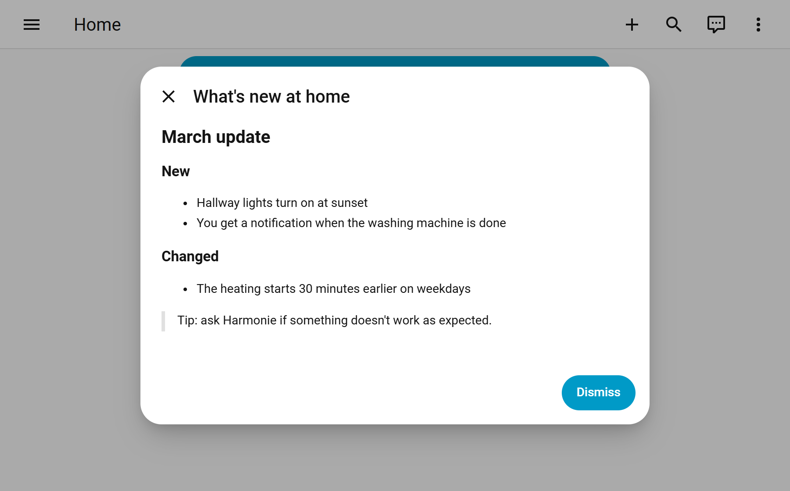

# Harmonie's Changelogs



Harmonie's Changelogs is a dashboard card for Home Assistant that tells the people in your home what changed. Write your changelog in markdown, in an entity or a markdown file. The popup opens once for each user, the first time they open the dashboard after the changelog changes. You can also show a button with an unread dot instead, or hide the button entirely.

## Table of Contents

- [Installation](#installation)
- [How to use](#how-to-use)
- [Options](#options)
- [Where to write your changelog](#where-to-write-your-changelog)
- [Contributing](#contributing)
- [Links](#links)
- [License](#license)

## Installation

### Marketplace (Recommended)

Go to Settings > Marketplace and search for "Harmonie's Changelogs"

or

[](https://my.home-assistant.io/redirect/hacs_repository/?owner=harmonie-durrant&repository=harmonie-changelogs&category=frontend)

Requires Home Assistant 2026.11 or newer.

## How to use

Add the card to a dashboard from the card picker ("Harmonie's Changelog") and set it up in the visual editor, or in YAML:

```yaml
type: custom:changelog-card
url: /local/changelog.md
```

- **The popup opens once per user.** It opens the first time each Home Assistant user loads the dashboard after the changelog text changes. "Seen" is stored per user in Home Assistant, so it syncs across their devices. Restarting Home Assistant doesn't show it again.
- **The changelog is rendered as markdown** by Home Assistant's own markdown component, the same one the Markdown card uses.
- **The card is translated** into English and French, following each user's Home Assistant language.

## Options

| Option | Required | Description |
| --- | --- | --- |
| `url` | One of `url` or `entity` | A markdown file to load, e.g. `/local/changelog.md`. |
| `entity` | One of `url` or `entity` | An entity holding the changelog. |
| `attribute` | No | With `entity`: read the changelog from this attribute instead of the state. |
| `title` | No | Popup title. Defaults to "Changelog". |
| `auto_open` | No | `false` to stop the popup opening by itself. The button then shows an unread dot until the user opens it. Default `true`. |
| `hide_button` | No | Hide the button. The popup still opens when the changelog changes. |
| `button_text` | No | Text for the button. Defaults to "Show changelog". |

Every option can also be set from the visual card editor.

## Where to write your changelog

### A markdown file (recommended for long changelogs)

Create `changelog.md` in the `www` folder of your Home Assistant config, for example with the File editor or Studio Code Server add-on. Then point the card at it:

```yaml
type: custom:changelog-card
url: /local/changelog.md
```

There's no length limit. When you save the file, users see the new version the next time they open the dashboard. Dashboards that stay open, like wall tablets, pick it up within 10 minutes.

### An `input_text` helper (short changelogs)

Create a Text helper (Settings > Devices & services > Helpers) and use it as the entity. You can change it by hand or from an automation. States are limited to 255 characters; write `\n` for a new line.

```yaml
type: custom:changelog-card
entity: input_text.changelog
```

### An entity attribute

Attributes aren't limited to 255 characters, so a template sensor works too:

```yaml
# configuration.yaml
template:
  - sensor:
      - name: Changelog
        state: "v2.0"
        attributes:
          content: |
            ## v2.0
            - A changelog as long as you like
```

```yaml
type: custom:changelog-card
entity: sensor.changelog
attribute: content
```

## Contributing

Feel free to fork this repo and submit your changes through pull requests, or to suggest a feature/report a bug, make an issue in the issues tab of this repository.

### Development environment

Requirements: [Node.js](https://nodejs.org/) and [Docker](https://www.docker.com/).

```sh
npm ci           # install dependencies
npm run watch    # rebuild dist/index.js on every change in src/
npm run ha:up    # start a local Home Assistant on http://localhost:8123
```

The first time, finish Home Assistant's onboarding (create a local user). Then add the card to a dashboard, using `input_text.changelog` as the entity.

- `dist/` is mounted into Home Assistant as `/local/harmonie-changelogs/` and loaded as a Lovelace resource. After a rebuild, hard-refresh the browser (Ctrl+Shift+R), or keep DevTools open with "Disable cache" ticked.
- To trigger the popup, change the value of `input_text.changelog` (Settings > Entities).
- For a changelog longer than 255 characters, use `entity: sensor.long_changelog` with `attribute: content`.
- "Seen" state is saved in Home Assistant's per-user frontend storage under the key `harmonie_changelogs_seen`. To see the popup again, change the changelog text, or log in as a different user.
- Home Assistant config lives in [dev/config/configuration.yaml](dev/config/configuration.yaml). Run `npm run ha:logs` to view logs and `npm run ha:down` to stop.
- Translations are in [src/translations/](src/translations/). To add a language, copy `en.json` and register it in [src/localize.js](src/localize.js).

### Tests

The end-to-end tests start a fresh Home Assistant in Docker with the built card, and drive Chrome through it: popup, seen state, markdown files, badge, warnings, editor and translations.

```sh
npm run build
npm run test:e2e
```

They run on every push and pull request against the minimum supported Home Assistant version and the latest release. Set `CHROME_PATH` if Chrome isn't found, and `SCREENSHOT_DIR` to keep screenshots.

### Releasing

`dist/` isn't committed. Releases are built by GitHub Actions:

1. Set `version` in [package.json](package.json) (e.g. `1.0.0`) and commit.
2. Push a matching tag: `git tag v1.0.0 && git push origin v1.0.0`.

The release workflow runs the tests, builds the card, and publishes a GitHub release with `index.js` attached and generated release notes. The Marketplace picks up the new release from there.

## Links

[Discord Server for support and discussion](https://discord.gg/Cjakvt9XJH)

[Buy me a coffee.](https://buymeacoffee.com/harmonie)

## License

Released under the [MIT License](LICENSE).
